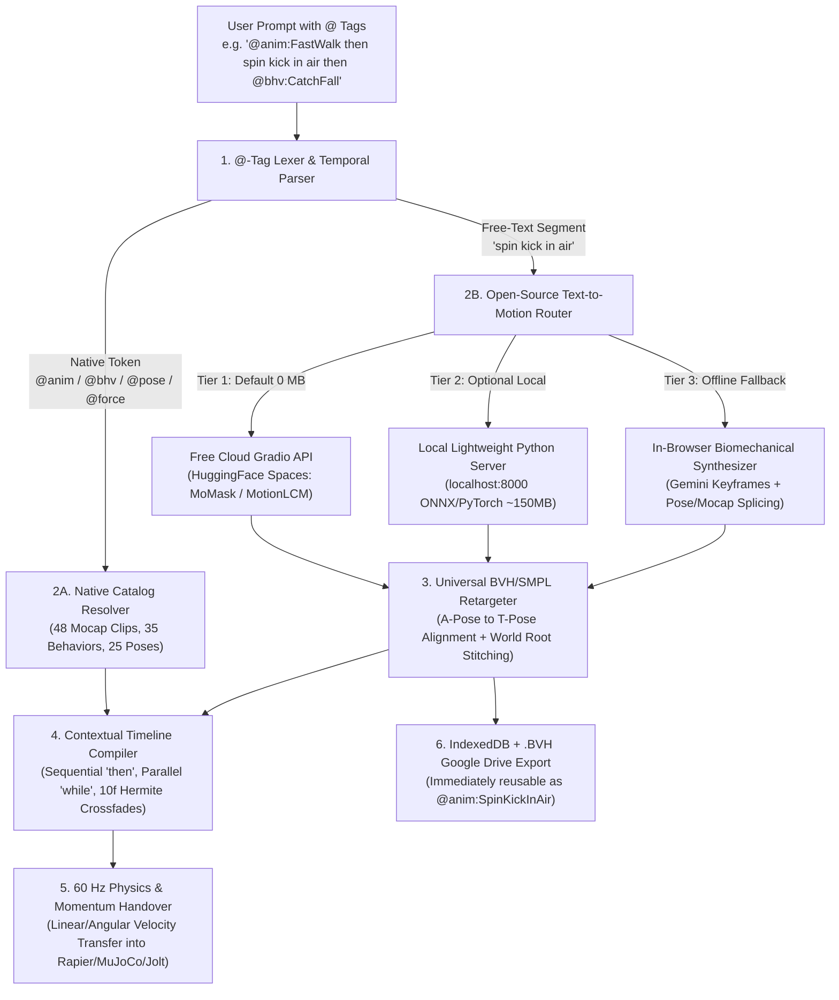

# OpenDMS — Hybrid Text-to-Animation AI & `@`-Tagging Compiler Blueprint

This blueprint defines the architecture for integrating **Open-Source Text-to-Motion AI** with **Native `@`-Tagging Compilation** inside OpenDMS, along with deep analysis from the perspectives of a **3D Stunt Animator**, a **Physics/System Developer**, an **End User**, and **Hardware Performance Engineering**.

---

## 1. System Architecture & Execution Pipeline

---

## 2. The `@`-Tagging Domain-Specific Language (DSL)

By combining natural language with explicit `@` system tags, the user has **100% deterministic control** over when OpenDMS uses its native assets/physics versus when it invokes the AI Text-to-Motion generator.

### Supported `@` Tag Namespaces (with Live Autocomplete Popup)
| Tag Prefix | Target System | Examples | Timeline Output |
| :--- | :--- | :--- | :--- |
| **`@bhv:`** | All 35 Endorphin 2.7 Behaviors | `@bhv:CatchFall`, `@bhv:ActiveBalance`, `@bhv:ArmsWindmill`, `@bhv:BodyFoetal`, `@bhv:Tackle` | Adds a `BEHAVIOR` track with PD joint motor gains |
| **`@anim:`** | 48 Native Mocaps + Any Saved AI Clip | `@anim:FastWalk`, `@anim:BoxerPunching`, `@anim:SoccerPowerKick`, `@anim:SpinKick` | Adds a retargeted `ANIMATION` track |
| **`@pose:`** | 25 Endorphin Calibration Poses | `@pose:NaturalStance`, `@pose:BoxingSideOn`, `@pose:Crouching`, `@pose:AirSpread` | Inserts an Active Pose keyframe / transition |
| **`@force:`** | Directional Impulse & Field Effectors | `@force:ChestShove`, `@force:BackTackle`, `@force:PusherWind`, `@force:Twister` | Adds a `PERTURBATION` impulse or field |
| **`@prop:`** | Physical Scene Obstacles | `@prop:Crate`, `@prop:Wall`, `@prop:Stairs`, `@prop:Pool`, `@prop:Projectile` | Spawns physical environment prop |
| **`@actor:`** | Multi-Character Target Routing | `@actor:1`, `@actor:2`, `@actor:both` | Routes subsequent clips/behaviors to Hero or Opponent |

### Temporal Connectors Recognized by the Compiler
1. **Sequential (`then`, `->`, `afterward`, `followed by`)**:
   - Places the next clip/behavior at the `endFrame` of the previous clip, with an automatic **10-frame Hermite S-curve crossfade** (`blendIn: 10, blendOut: 10`) and **Root World Position Continuity** ($\Delta X, \Delta Z$ offset stitching so the character never teleports back to $(0,0,0)$ between clips).
2. **Simultaneous / Layered (`while`, `with`, `+`, `during`)**:
   - Places the behavior or upper-body action on the **same frame range** (`startFrame` to `endFrame`) as the active animation (e.g., `"walk forward carefully while @bhv:HeadProtect"` blends upper-body head shielding over the walking locomotion).
3. **Frame / Duration Modifiers (`for 2s`, `for 90f`, `at frame 60`)**:
   - Explicitly sets the generated clip duration or start frame.

---

## 3. Multi-Perspective Insight Analysis

### A. From the Perspective of a 3D / Stunt Animator
> [!TIP]
> **Why this is a game-changer for animation:** Traditional Text-to-Motion AI tools (like standalone MDM or MotionGPT demos) have a fatal flaw for production animators: **they output "dead" kinematic skeletons that ignore gravity, floor collisions, and physical impacts.**

1. **Solving the "Kinematic Uncanny Valley" with Physics Handover**:
   - In pure AI text-to-motion, if you prompt *"a character jumps and crashes into a wall"*, the AI hallucinates a fake fall that clips through the floor or floats in mid-air.
   - In OpenDMS, you write: `"sprint and leap forward through the air then @bhv:CatchFall"`. The AI only generates the **voluntary human motion** (the sprint and leap), and at the exact peak of the jump, OpenDMS transfers the 60 Hz linear and angular momentum into the **Rapier/MuJoCo/Jolt ragdoll** with `@bhv:CatchFall`. The wall impact, bone collisions, and ground tumbling are 100% physically accurate.
2. **Root-Motion Stitching & Non-Destructive NLE Editing**:
   - Animators hate when an AI generates a 5-second clip where only 1.5 seconds are usable. Because every AI-generated clip lands on our NLE timeline as a standard `ANIMATION` layer, you can immediately use our **`✂️ Split (S)`**, **`⇤ Trim In ([)`**, and **`⇥ Trim Out (])`** tools to cut out the best 40 frames of the AI motion and blend it into `@bhv:Stagger`.
3. **Iterative Library Building**:
   - Once the AI generates a great `"drunken stumble"` or `"backflip kick"`, saving it to the Mocap Library turns it into a permanent `@anim:DrunkenStumble` tag that you can reuse across characters (`@actor:1`, `@actor:2`) and scenes without waiting for AI generation again.

---

### B. From the Perspective of a System Developer
> [!IMPORTANT]
> **Architectural Cleanliness:** The biggest engineering risk when adding generative AI to a real-time 60 FPS physics engine is **blocking the main WebGL/WASM thread** or creating **coordinate-space mismatches** between AI skeletons (usually 22-joint SMPL / HumanML3D) and physics ragdolls (our 15-bone Endorphin rig).

1. **Unified Skeleton Adapter (SMPL 22-Joint $\rightarrow$ OpenDMS 15-Bone)**:
   - Open-source models like **MoMask**, **MotionLCM**, and **MDM** output motions trained on the **HumanML3D (22-joint SMPL)** or **KIT-ML** dataset, exported as standard `.bvh`.
   - Because we already built the **Universal BVH/FBX Retargeter (`src/parsers/animationRetargeter.js`)** with automatic **A-Pose to T-Pose world bind compensation (`computeWorldBindMap`)**, OpenDMS can ingest raw BVH strings from MoMask/MDM with **zero new rigging math**.
2. **World-Space Root Offset Continuation (`rootOffset` Stitching)**:
   - When chaining `@anim:FastWalk` (ends at $Z = +2.4\text{ m}$) $\rightarrow$ AI clip `"spin kick"` (which starts at local $(0,0,0)$ in the AI model's output), the compiler must capture the world $(X, Z)$ Pelvis translation and yaw heading at the end of Clip 1 and apply it as a root transform matrix to Clip 2. That keepschained animations seamless in 3D space.
3. **Asynchronous Non-Blocking Pipeline**:
   - The browser's 60 FPS `requestAnimationFrame` physics loop must never stutter while waiting 2–4 seconds for an AI motion clip. All AI generation happens asynchronously via `fetch()` / WebSockets, showing a sleek progress indicator on the timeline track before injecting the compiled keyframes.

---

### C. From the Perspective of an End User
1. **Zero Friction / No Command-Line Headaches**:
   - A regular user opening OpenDMS on a laptop via Google Drive doesn't want to install CUDA toolkits, Conda environments, or 10 GB of PyTorch checkpoints just to generate a 3-second animation.
   - Having **Tier 1 (Free Cloud Gradio API)** work out-of-the-box with **0 MB of local setup** means the feature works the very second you open the app on any device.
2. **Discoverability via `@` Autocomplete**:
   - Users shouldn't have to memorize the exact names of 35 Endorphin behaviors or 48 mocap files. As soon as the user types `@`, a clean floating menu pops up filtered by category (`Behaviors`, `Animations`, `Poses`, `Forces`), Completable with `Tab` or `Enter`.
3. **Predictable Behavior**:
   - Before `@` tagging, a user typing *"do a fast walk and catch fall"* couldn't tell if the AI was going to pick a preset or hallucinate something new. With `@anim:FastWalk` and `@bhv:CatchFall`, the user sees colored pill badges right in the prompt box and knows with 100% certainty what is native and what is AI-generated.

---

## 4. Hardware & Performance Insight (Cloud vs. Local Execution)

Here is an honest, engineering-level breakdown of what open-source Text-to-Motion models require on your hardware across the three execution tiers:

| Execution Tier | Model / Technology | Disk Space | RAM / VRAM Usage | Generation Speed (for 4-sec clip) | Best Hardware Fit |
| :--- | :--- | :--- | :--- | :--- | :--- |
| **Tier 1: Free Cloud API (Default)** | **MoMask / MotionLCM** via Hugging Face Spaces Gradio API | **0 MB** on your PC | **~15 MB** browser RAM (0 MB GPU) | **1.5 – 4.0 seconds** (runs on Hugging Face cloud GPUs) | **Any device** (Thin laptops, tablets, integrated graphics, synced Google Drive PCs) |
| **Tier 2: Local Lightweight Sidecar (Optional)** | **MotionLCM** (1-step Latent Consistency) or **MoMask** (Residual VQ-VAE) in Python | **~180 MB – 350 MB** (weights) + Python | **~1.2 GB RAM** (CPU mode) or **~1.5 GB VRAM** (GPU mode) | **0.2s** on NVIDIA RTX GPU / **1.8s – 3.5s** on modern CPU | Desktop PC or gaming laptop when working **100% offline** or wanting sub-second generation |
| **Tier 3: Built-in Procedural & Splicing Fallback** | **Gemini 2.0 Flash / Local Biomechanical Keyframe Solver** | **0 MB** on your PC | **~5 MB** browser RAM | **< 0.5 seconds** (Offline) / **1.2s** (Gemini API) | Instant fallback if offline and without the Python sidecar running |

### Why MoMask & MotionLCM Are the Best Open-Source Models (vs. Older MDM)
> [!NOTE]
> **Hardware Insight:** Older 2022–2023 Text-to-Motion models like **MDM (Motion Diffusion Model)** run 50 to 1,000 iterative denoising steps and use heavy CLIP-ViT-Large text encoders—taking **15–30 seconds on a CPU** and requiring **4+ GB of disk space**.
>
> By contrast, newer open-source architectures like **MoMask (CVPR 2024)** and **MotionLCM (ECCV 2024)**:
> 1. Quantize human motion into discrete residual tokens (RVQ-VAE) or use 1-to-4 step Latent Consistency distillation.
> 2. Have tiny model checkpoints (**~150 MB to 300 MB** total).
> 3. Run **10x to 30x faster** than diffusion models, making them fast enough to run even on a standard laptop CPU in 2–3 seconds if you ever choose to run the local sidecar, while being **instant (1–3 seconds)** over the free Hugging Face Gradio API with **zero load on your PC**.

---

## 5. Implementation Roadmap (When You Are Ready to Build)

1. **Phase 1 — `@`-Tagging Autocomplete & Compiler UI (`index.html`, `src/dms/aiStuntDirector.js`)**:
   - Build the interactive `@` autocomplete floating menu above `#ai-prompt-input` supporting `@bhv:`, `@anim:`, `@pose:`, `@force:`, `@prop:`, and `@actor:`.
   - Build the multi-segment parser that splits prompts on `then` (sequential) and `while` (parallel) and stitches world-space $(X, Z)$ root coordinates across segments.
2. **Phase 2 — Open-Source Text-to-Motion Client (`src/dms/textToMotionClient.js`)**:
   - Implement the **Tier 1 Free Cloud Gradio API client** (connecting to open-source MoMask / MotionGPT spaces to fetch generated `.bvh` data directly in the browser).
   - Implement the **Tier 2 Localhost (`http://localhost:8000/generate-bvh`) hook** + an optional 1-click `start_local_motion_ai.bat` script for machines where you want local offline generation.
   - Implement the **Tier 3 Procedural Pose/Keyframe Synthesizer** so arbitrary prompts still generate multi-keyframe bone animations even with zero internet and zero Python installed.
3. **Phase 3 — Mocap Library Persistence & `.BVH` Export**:
   - Add the **"✨ AI Generated"** category tab inside the Endorphin Motion Capture Library modal (`#modal-mocap-library`).
   - Persist generated BVH clips in browser `IndexedDB` and add a **💾 Save .BVH to Project** button so clips sync across all your devices via `G:\My Drive\OpenDMS` and immediately appear in `@anim:` autocomplete.
