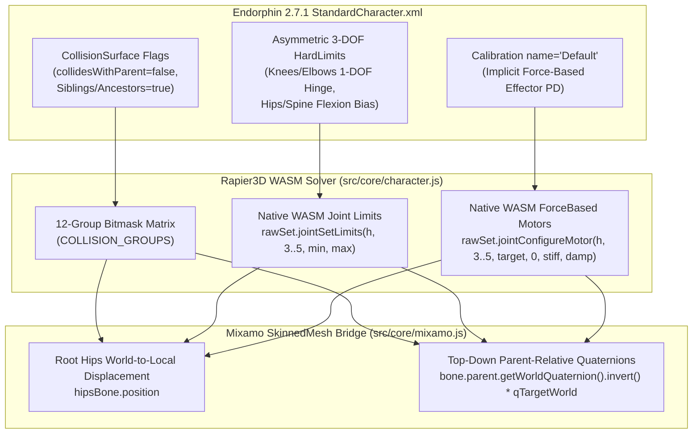

# NaturalMotion Endorphin 2.7.1 — Anatomical Ragdoll & Mixamo Skinning Blueprint

## 1. REA Physics Analysis of Endorphin 2.7.1 (`StandardCharacter.xml` & `endorphin.exe`)

Using REA against `C:\Program Files (x86)\NaturalMotion\endorphin 2.7.1\endorphin.exe` and the embedded `StandardCharacter` (`Version 230`, `Mass 90.0 kg`, `Height 185.0 cm`) revealed four core subsystems that govern how an Endorphin character behaves when simulated on a blank timeline:

1. **Non-Adjacent Bone Self-Collision Matrix (`<CollisionSurface>`)**:
   - In Endorphin's `<CollisionSet name="Default">`, every body part declares `<CollisionSurface>` capsules with explicit topology flags:
     - `collidesWithParent="false"` (prevents adjacent joint-anchor binding)
     - `collidesWithSiblings="true"` on thighs/calves/feet and arms
     - `collidesWithAncestors="true"` on forearms, hands, calves, feet, and head
   - Consequently, **legs collide with each other**, **arms collide with the torso, head, pelvis, and legs**, and **torso/head collide with the legs** so limbs stack naturally on the floor instead of passing through one another.
2. **Asymmetric 3-DOF `<HardLimits>` & `PrimaryFrameOffset`**:
   - Endorphin's `<SkeletalJoint>` definitions use asymmetric physiological ranges (`Swing1Angle`, `Swing2Angle`, `TwistAngle`, and `PrimaryFrameOffset` quaternions) rather than symmetric cones:
     - **Knees (`LeftKnee`, `RightKnee`)**: Strictly 1-DOF hinge (`[0.0, 2.15 rad]`) preventing knee hyperextension (`< 0 rad`).
     - **Elbows (`LeftElbow`, `RightElbow`)**: Strictly 1-DOF hinge (`[0.0, 2.25 rad]`).
     - **Hips (`LeftHip`, `RightHip`)**: Deep forward flexion (`-1.45 rad`) toward the chest with restricted backward extension (`+0.28 rad`) so the pelvis cannot hyperextend into a back-bridge.
     - **Spine & Neck (`LowerSpine`, `UpperSpine`, `Neck`, `Head`)**: Forward flexion bias (`+0.42 rad` vs `-0.18 rad` extension) so the torso curls naturally when folding.
3. **Implicit Force-Based `<Effector>` Motors (`<Calibration name="Default">`)**:
   - Even with no active behavior node on the timeline, Endorphin's `<Calibration name="Default">` applies implicit joint stiffness and damping (`Stiffness = 5.0–7.0`, `Damping = 0.5–0.9`, scaled by per-effector `<Base>` weights where `LowerBack` and `Pelvis` carry `Stiffness = 14`, `Knees` carry `11`, and `Arms/Shoulders` carry `7–8.5`).
   - Crucially, these motors are **implicit force/torque springs** solved simultaneously with joint limits inside the constraint solver—not explicit post-step `addTorque` impulses.
4. **Zero Initial Foot Drop Shock**:
   - In T-pose at Frame 0, the bottom of the foot collision boxes rests flush with the ground plane (`y = 0.000 m`), avoiding an artificial free-fall landing shock on Frame 1 that would immediately buckle both knees straight down.

---

## 2. Prototype Physics Architecture ([`src/core/character.js`](file:///c:/Users/USER/Downloads/REA/src/core/character.js) & [`src/core/physics.js`](file:///c:/Users/USER/Downloads/REA/src/core/physics.js))

### Key Upgrades Implemented
- **12-Group Non-Adjacent Self-Collision Matrix ([`COLLISION_GROUPS`](file:///c:/Users/USER/Downloads/REA/src/core/character.js#L15-L62))**:
  - Assigned dedicated collision bitmasks to `PELVIS`, `LOWER_SPINE`, `UPPER_SPINE`, `HEAD_NECK`, `L_UPPER_ARM`, `L_FOREARM`, `R_UPPER_ARM`, `R_FOREARM`, `L_THIGH`, `L_CALF_FOOT`, `R_THIGH`, and `R_CALF_FOOT`.
  - Adjacent parent-child segments exclude each other (`joint.setContactsEnabled(false)` + bitmask exclusion) for zero T-pose binding, while non-adjacent limbs (Left Leg vs. Right Leg, Arms vs. Torso/Head/Legs, Torso/Head vs. Legs) collide solidly.
- **Native Rapier WASM 3-DOF Angular Limits & `ForceBased` Motors ([`buildHumanoid`](file:///c:/Users/USER/Downloads/REA/src/core/character.js#L682-L704))**:
  - Wired `joint.rawSet.jointSetLimits(handle, axis, min, max)` and `joint.rawSet.jointConfigureMotorModel(handle, axis, RAPIER.MotorModel.ForceBased)` directly on axes `3, 4, 5` (`AngX`, `AngY`, `AngZ`) of all spherical and revolute joints.
  - Replaced explicit post-step Euler clamping with [`applyPassiveRagdollDynamics`](file:///c:/Users/USER/Downloads/REA/src/core/character.js#L817-L880), which maintains postural column support while upright and yields smoothly into anatomical hip/knee/spine folding as the center of mass tips past the support polygon.

---

## 3. Mixamo `X Bot.fbx` Rigging & Skinning Fix ([`src/core/mixamo.js`](file:///c:/Users/USER/Downloads/REA/src/core/mixamo.js))

### Root Cause of Previous T-Pose Freeze
1. **Three.js `WebGLRenderer` Matrix Overwrite**: Setting `bone.matrixAutoUpdate = false` and writing `bone.matrixWorld` directly in `mixamoBridge.update()` was overwritten every frame inside `renderer.render(scene, camera)` because `scene.updateMatrixWorld()` recomputes `bone.matrixWorld = bone.parent.matrixWorld * bone.matrix` from each bone's local `position`/`quaternion`/`scale` before `SkinnedMesh.skeleton.update()` uploads `boneMatrices` to the GPU.
2. **Scaled FBX Root Hierarchy (`0.00967` Centimeter-to-Meter Scale)**: Extracting parent world rotation via `setFromRotationMatrix(bone.parent.matrixWorld)` on a scaled FBX hierarchy (`scale = 0.00967`) produced non-unit quaternions whenever a bone rotated `180°` (such as Mixamo leg bones), collapsing lower-body scale to zero.

### Solution Implemented in [`MixamoCharacterBridge`](file:///c:/Users/USER/Downloads/REA/src/core/mixamo.js#L123-L299)
- Kept `bone.matrixAutoUpdate = true` and set `child.frustumCulled = false` on all `SkinnedMesh` children (`Beta_Surface` and `Beta_Joints`).
- Recorded each bone's T-pose `restWorldQuat` and `restLocalQuat`, plus the `mixamorigHips` rest world position and parent inverse matrix.
- Every frame in [`MixamoCharacterBridge.update()`](file:///c:/Users/USER/Downloads/REA/src/core/mixamo.js#L222-L299):
  - Computes each physics segment's world rotation delta from `b.mesh.quaternion` (so the Mixamo character animates identically during live physics, timeline playback, and frame scrubbing).
  - Updates `this.hipsBone.position` in local space from `Pelvis` world displacement.
  - Iterates top-down through `this.boneBindings`, extracts the parent's pure rotation via `bone.parent.getWorldQuaternion(this._parentWorldQuat)` (immune to the `0.00967` root scale), and writes the exact local `bone.quaternion` before calling `sm.skeleton.update()`.
