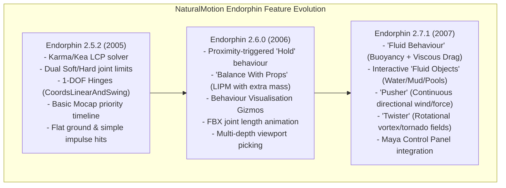

# Reverse Engineering Analysis: Endorphin 2.5.2 vs. 2.7.1 vs. OpenDMS Prototype

Through REA disassembly and file analysis of both installations:
- **Baseline Version**: `C:\Program Files (x86)\NaturalMotion\endorphin 2.5.2`
- **Updated Version**: `C:\Program Files (x86)\NaturalMotion\endorphin 2.7.1`

This document details the exact architectural evolution between 2.5.2 and 2.7.1, compares them against our current **OpenDMS** prototype, and outlines what to pick for our development roadmap.

---

## 1. Feature & Architecture Comparison Matrix

| Feature / Engine Domain | Endorphin 2.5.2 | Endorphin 2.7.1 (New Findings) | Current OpenDMS Prototype | Recommendation for Prototype |
| :--- | :--- | :--- | :--- | :--- |
| **Physics Solver Engine** | MathEngine Kea / Karma (PGS LCP 120 Hz) | Enhanced Kea with non-spherical inertial solver | Rapier 3D WASM (Modern PGS / Featherstone, 120 Hz) | **Retain Rapier 3D WASM** (Modern 64-bit multi-threaded, faster than 2007 Kea) |
| **Joint Limit Enforcement** | Dual-zone Soft limits ($10\text{ N}\cdot\text{m}$) + Hard limits | Same dual-zone model with tuned secondary damping | Dual-zone Soft/Hard with Quaternion Swing-Twist projection | **Already achieved parity** with 2.7.1 joint limits |
| **Physical Effect Behaviours** | Only gravity and instantaneous impulse hits | **1. Fluid Behaviour** (Buoyancy + Drag) **2. Pusher** (Linear continuous force) **3. Twister** (Rotational vortex field) | Constant wind vector, projectile impulse hits | **ADOPT (High Priority)**: Implement interactive **Fluid / Water Volumes** with buoyancy & drag, and **Twister Vortex** |
| **Environment Objects** | Ground plane and static rigid props | **Fluid Objects / Water Volumes** (interactive 3D water bodies with fluid interaction) | Concrete ground, obstacle crate, boulder projectile, step | **ADOPT (High Priority)**: Add 3D Water Volume with translucent water surface and Archimedes physics |
| **Proximity Behaviours** | Fixed frame timing only | **Hold Behaviour**: Proximity-triggered constraints (hands grab when distance $< d$) | Timeline frame range triggers | **ADOPT (Medium Priority)**: Add proximity grab trigger when near obstacles |
| **Prop Interaction** | Standalone ragdoll only | **Balance With Props**: Dynamically shifts LIPM Center of Mass when carrying objects | Standalone LIPM balance | **ADOPT (Medium Priority)**: Incorporate held prop mass into CoM calculation |
| **Viewport Visualisation** | Wireframe/primitive collision capsules | **Behaviour Visualisation**: Helper graphics for balance CoP, reach cones, and waterlines | Stylized Biomechanical Mannequin with visor and joint pins | **ADOPT (High Priority)**: Add floor Center-of-Pressure (CoP) reticle and support base polygon |
| **Materials & Interactions** | 8 materials in `DefaultScene.ens` (`ice, rubber, sponge, steel, tarmac`) | Extended material interaction matrices | 4 selectable materials (Concrete, Ice, Rubber, Sponge) | **Already integrated** |

---

## 2. Deep Dive: Endorphin 2.7's Headline Physics Systems

### A. Fluid Behaviour & Fluid Objects (Tutorial 15 in 2.7.1)
In Endorphin 2.7, NaturalMotion added fluid dynamics for water, mud, quicksand, and pools.
The mathematical formulation is:

1. **Buoyancy Force (Archimedes' Principle)**:
   $$F_{\text{buoyancy}} = \rho_{\text{fluid}} \cdot V_{\text{submerged}} \cdot g$$
   * For water: $\rho \approx 1000\text{ kg/m}^3$.
   * A human body of mass $75\text{ kg}$ has volume $V \approx 0.075\text{ m}^3$, so when fully submerged, $F_{\text{buoyancy}} \approx 750\text{ N}$, which balances gravity and makes the body float.
2. **Quadratic Hydrodynamic Drag**:
   $$\mathbf{F}_{\text{drag}} = -\frac{1}{2} C_d \cdot \rho_{\text{fluid}} \cdot A \cdot \|\mathbf{v}\| \mathbf{v}$$
   * Causes limbs to slow down drastically when plunging into water, creating fluid resistance.

### B. Twister Behaviour (Vortex Force Field)
Applies a rotational swirl around a vertical vortex axis $\mathbf{a}_v$:
$$\mathbf{F}_{\text{tangential}} = \omega \cdot (\mathbf{a}_v \times (\mathbf{p} - \mathbf{c}_v))$$
$$\mathbf{F}_{\text{suction}} = -k_{\text{inward}} \cdot (\mathbf{p} - \mathbf{c}_v)_{\perp}$$

### C. Behaviour Visualisation Gizmos (Endorphin 2.6/2.7)
* **Support Polygon**: A glowing dynamic outline projected onto the floor connecting the feet.
* **Center of Mass Reticle**: A vertical plumb line from the character's pelvic CoM down to the floor, showing when the character is within vs. outside the support base.

---

## 3. Implementation Plan for OpenDMS

We can pick the best advancements from 2.7.1 and integrate them into our running prototype:

1. **Interactive Water / Fluid Volume**:
   * Add a **"🌊 Spawn Water Pool"** button.
   * Renders a translucent cyan water volume with water surface shimmer.
   * Computes Archimedes buoyancy and viscous drag on every submerged limb in real time.
2. **Twister Vortex Force Field**:
   * Add a **"🌪️ Twister Vortex"** field that pulls and rotates limbs in a spiral.
3. **Viewport Biomechanical Visualisation Gizmos**:
   * Draw the dynamic floor support polygon between the feet.
   * Draw the Center-of-Mass (CoM) vertical ground projection reticle.
